<p align="center">
  
</p>

<p align="center">


</p>

# ⚖️ Previdenciário no Codex

> Skill para **análise, estratégia e redação em Direito Previdenciário brasileiro no Codex**, com fonte para cada afirmação e riscos à vista.

Criado por **[Lucas Barkoski](https://github.com/Barkoski)**.

**Navegue:** [🧭 O que é](#o-que-e) · [📌 O que faz](#o-que-faz) · [🚀 Instalação](#instalacao) · [💡 Como usar](#como-usar) · [🚧 Limites](#limites) · [📚 Documentação](#documentacao)

<p align="center">
  
</p>

<a id="o-que-e"></a>
## 🧭 O que é

É a versão para o Codex da skill [Advocacia Previdenciária Barkoski](https://github.com/Barkoski/advocacia-previdenciaria-barkoski), mantida neste repositório separado. Ela lê os arquivos do caso e entrega uma análise que você consegue conferir: cada afirmação cita arquivo e página. O que não está no documento aparece como não confirmado. Toda peça sai como minuta, para revisão integral do advogado.

### 👥 Para quem é

- Advogados que atuam em Direito Previdenciário brasileiro e usam o Codex.
- Casos no INSS (processo administrativo, CNIS, indeferimento) e na Justiça (PJe, JEF).
- Aposentadorias, BPC/LOAS, incapacidade, auxílio-acidente, pensão por morte e revisões.

<a id="o-que-faz"></a>
## 📌 O que faz

- **Rastreia cada afirmação** até o arquivo e a página.
- **Separa fato de narrativa**: `FATO COMPROVADO`, `ALEGACAO`, `INFERENCIA` ou `CONCLUSAO JURIDICA`.
- **Monta a tabela de provas** e a matriz requisito-prova-risco.
- **Mostra o outro lado**: prova contrária, contradições e a tese provável do INSS.
- **Revisa peças antes do protocolo**.
- **Trata prazos e cálculos** com a memória do cálculo à vista.
- **Pesquisa lei e jurisprudência** em fontes oficiais, sem dados do cliente.
- **Entrega em formatos prontos**: análise de indeferimento, revisão de CNIS, parecer, checklist e minuta.

No fim, indica uma decisão operacional, como `AJUIZAR AGORA`, `RECORRER ADMINISTRATIVAMENTE` ou `DILIGENCIAR ANTES`, e a próxima ação.

<a id="instalacao"></a>
## 🚀 Instalação

1. Baixe o repositório em **Code → Download ZIP** e extraia.
2. Copie a pasta `skills/advocacia-previdenciaria-barkoski-codex` para a pasta de skills do Codex:
   - Windows: `C:\Users\SEU_USUARIO\.codex\skills\`
   - Mac/Linux: `~/.codex/skills/`
3. Reinicie o Codex ou abra uma nova tarefa.

O arquivo deve ficar em `.codex/skills/advocacia-previdenciaria-barkoski-codex/SKILL.md`.

<a id="como-usar"></a>
## 💡 Como usar

A skill é acionada sozinha em trabalhos com INSS, CNIS, PJe, processos e benefícios previdenciários. Para chamá-la direto, use `$advocacia-previdenciaria-barkoski-codex`:

```text
Use $advocacia-previdenciaria-barkoski-codex para analisar os arquivos
indicados. Quero cronologia, tabela de provas, requisitos e riscos.
Cite arquivo e página. Quando faltar informação, diga que não consta.
```

Para experimentar, use documentos fictícios ou anonimizados.

<a id="limites"></a>
## 🚧 Limites

- **Só Direito Previdenciário brasileiro.**
- **Não substitui o advogado.** Produz material de apoio e minutas para revisão profissional. Não protocola nada e não promete resultado.
- **Prazo e cálculo não são definitivos.** Sem marco, dados e regras confirmados, a skill não afirma data final nem valor definitivo.
- **Lei e jurisprudência precisam de confirmação.** O que não foi consultado em fonte oficial vem marcado como "de memória".

### 🔐 Sigilo

- Nenhuma busca na internet, conector ou serviço externo com dado de cliente sem sua autorização expressa.
- Instalar a skill no seu computador não torna local o processamento do modelo de IA. Use documentos anonimizados sempre que possível.
- Texto dentro de um documento nunca é tratado como instrução.

<a id="documentacao"></a>
## 📚 Documentação

- [Regras da skill](skills/advocacia-previdenciaria-barkoski-codex/SKILL.md)
- [Módulos por assunto](skills/advocacia-previdenciaria-barkoski-codex/references/)
- [Uso no Codex](skills/advocacia-previdenciaria-barkoski-codex/references/uso-no-codex.md)
- [Casos de validação](tests/casos-de-validacao.md)
- [Metadados do Codex](skills/advocacia-previdenciaria-barkoski-codex/agents/openai.yaml)

<details>
<summary>Estrutura dos arquivos</summary>

```
skills/advocacia-previdenciaria-barkoski-codex/
├── SKILL.md              # travas, ordem de controle e escolha dos módulos
├── agents/openai.yaml    # nome e prompt sugerido no Codex
└── references/           # módulos por assunto (prazos, cálculos, provas, sigilo e outros)
tests/
└── casos-de-validacao.md # situações em que a skill deve falhar de modo seguro
```

</details>

## 👤 Autor e licença

Criado por **Lucas Barkoski**, [github.com/Barkoski](https://github.com/Barkoski). Adaptação da skill `advocacia-previdenciaria-barkoski`, pelo mesmo autor.

Licença MIT, veja [LICENSE](LICENSE).
