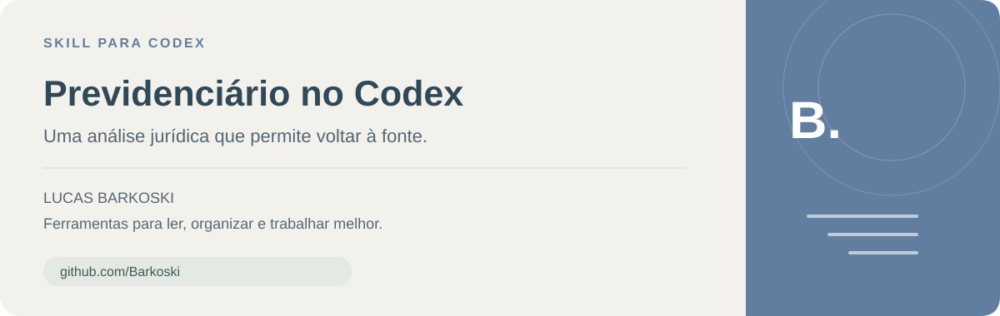

<p align="center">
  
</p>

<p align="center">


</p>

# ⚖️ Previdenciário no Codex

> Skill para apoiar **análise, estratégia e redação previdenciária no Codex**, com fontes, provas e riscos à vista.

Criado por **[Lucas Barkoski](https://github.com/Barkoski)**.

**Explore:** [📚 Documentação](#documentacao) · [💡 Exemplo de pedido](#secao-1) · [📌 Principais controles](#secao-2) · [🚀 Instalação no Codex](#secao-3) · [🗂️ Estrutura](#secao-4) · [🚧 Limites](#secao-5)

<p align="center">
  
</p>

Versão independente da [skill original](https://github.com/Barkoski/advocacia-previdenciaria-barkoski), mantida em repositório separado.

<a id="secao-1"></a>
## 💡 Exemplo de pedido

```text
Use $advocacia-previdenciaria-barkoski-codex para analisar os arquivos
indicados. Quero cronologia, tabela de provas, requisitos e riscos.
Cite arquivo e página. Quando faltar informação, diga que não consta.
```

**Para experimentar:** use documentos fictícios ou sanitizados. A instalação local da skill não torna local o processamento do modelo.

<a id="secao-2"></a>
## 📌 Principais controles

- rastreabilidade entre afirmação, arquivo e página;
- separação entre fato comprovado, alegação, inferência e conclusão jurídica;
- tabela de provas e matriz requisito-prova-risco;
- análise adversarial e melhor tese provável do INSS;
- proteção de dados e autorização antes de qualquer envio externo;
- pesquisa jurídica em fontes oficiais;
- prazos e cálculos com memória reproduzivel;
- minutas sempre sujeitas a revisão integral do advogado.

<a id="secao-3"></a>
## 🚀 Instalação no Codex

1. Baixe o repositório em **Code → Download ZIP** e extraia.
2. Copie a pasta `skills/advocacia-previdenciaria-barkoski-codex` para a pasta de skills do Codex, dentro da sua pasta de usuário.

No Windows, o caminho final é:

```text
C:\Users\SEU_USUARIO\.codex\skills\advocacia-previdenciaria-barkoski-codex
```

Reinicie o Codex ou inicie uma nova tarefa. A skill será acionada em trabalhos com INSS, CNIS, PJe, processos e benefícios previdenciários.

<a id="secao-4"></a>
## 🗂️ Estrutura

```text
skills/advocacia-previdenciaria-barkoski-codex/
|- SKILL.md
|- agents/openai.yaml
`- references/
```

<a id="secao-5"></a>
## 🚧 Limites

A skill produz material de apoio e minutas para revisão profissional. Não substitui o advogado, não protocola automaticamente, não promete resultado e não transforma estimativa em calculo definitivo.

<a id="secao-6"></a>
## 📜 Origem e licença

Adaptação autorizada da skill `advocacia-previdenciaria-barkoski`, mantida em repositorio separado. Licença MIT.

<a id="documentacao"></a>
## 📚 Links para continuar

- [Skill central](skills/advocacia-previdenciaria-barkoski-codex/SKILL.md)
- [Referências](skills/advocacia-previdenciaria-barkoski-codex/references/)
- [Metadados do Codex](skills/advocacia-previdenciaria-barkoski-codex/agents/openai.yaml)
